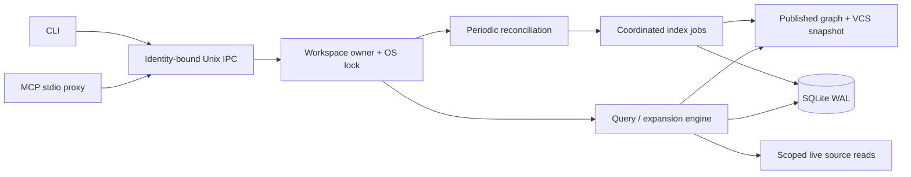

# LEDGER architecture: implemented core and future direction

LEDGER is a local repository evidence compiler, served through a Unix CLI and stdio MCP. This document distinguishes the implemented CLI/MCP core from the broader product design. It is not a claim that every target capability or performance goal has been delivered.

## Current implementation

The Rust workspace separates scope/identity/formatting (`ledger-core`), lexical retrieval (`ledger-search`), scoped parsing and contract extraction (`ledger-parser`), repository history (`ledger-vcs`), SQLite/graph/handle storage (`ledger-store`), the engine and ownership protocol (`ledger-daemon`), stdio protocol (`ledger-mcp`) and terminal commands/fixture benchmarks (`ledger-cli`).

### Ownership, transport and lifecycle

Concurrent clients for the same canonical checkout share one daemon. Different checkout roots, including separate worktrees, have distinct workspace IDs. The owner holds an exclusive OS advisory lock on `.ledger/runtime/daemon.lock` before opening/migrating SQLite. Socket-file existence does not establish ownership. Production callers never fall back to an unlocked engine; explicit embedded clients are limited to opt-in library use, isolated tests and synthetic benchmarks.

The handshake carries protocol, schema, executable fingerprint, canonical workspace ID, database incarnation and owner lifetime. Executable fingerprinting is cached once per process. Each meaningful operation carries the observed identity and its response echoes it on the same socket, avoiding an unverified handshake-to-new-connection race. An owner checks database file identity before and after operations and during polling. Replacing an active database is unsupported; stop before restore and never rewrite it in place.

Upgrade/restart is negotiated only for a same-workspace daemon advertising `bound_shutdown_v1`. Build/schema compatibility can differ for that independent shutdown exchange. Legacy daemons without the capability fail actionably; there is no forced termination, unlocked migration or drain-and-exec promise. Restart is a drain followed by a fresh process startup. An already-connected client remains bound to its original owner; after owner idle exit/replacement, restart the proxy and re-query for handles.

Shutdown stops listener admission and refresh scheduling, drains accepted connection tasks, closes engine indexing admission, drains queued/running jobs and checkpoints SQLite. The socket is removed under the lock, then ownership releases. Index shutdown runs through `spawn_blocking` normally. A lifecycle guard also waits for registered blocking requests/indexing before unlocking if the server future unwinds or is cancelled. No shutdown timeout releases ownership with active writers. Client-side wait deadlines can report a slow drain without aborting the owner's work. Abrupt process termination relies on OS lock cleanup and SQLite recovery, not a promised application checkpoint.

IPC accepts one request per connection, at most 64 simultaneous connections, with a 4 MiB encoded request/response cap and five-second total request-read/response-write deadlines. Client response reads have a 120-second deadline. Silent/partial sockets cannot pin ownership indefinitely. MCP frames are newline-delimited UTF-8 JSON-RPC, with 1 MiB input and 4 MiB encoded output limits. MCP stdio has no idle timeout and stdout contains protocol responses only; diagnostics use stderr.

### Reconciliation and coherent publication

Automatic refresh is bounded periodic polling every two seconds while the owner is alive. It invokes `trigger_background_index`; pending jobs coalesce and unchanged parsed files/manifests are reused by path/content hash. Traversal still reads/hashes allowed files and observes VCS state; polling is not an OS event watcher or a latency guarantee. Missed timer ticks are skipped rather than replayed in a burst. Polling never resets the fixed idle deadline (default 15 minutes without an active IPC connection).

Explicit `index` and `query --fresh` wait for an index pass covering their request, including a follow-up when the current pass began earlier. Ordinary queries do not force a full pass. Cold queries use live lexical retrieval and local parsing while background indexing warms. New/deleted/renamed files, ignore rules, nested repository boundaries and edits outside selected targets are reconciled without first querying those files. Large scans/VCS failures can delay refresh; errors and coverage are part of the evidence contract.

The engine publishes graph and VCS together through one snapshot. Expensive graph work is built outside the short publication gate; database commit/snapshot swap and database-backed evidence reads use the gate to avoid mixing generations. Publication errors must propagate or explicitly degrade coverage rather than masquerading as an empty successful search. Per-query SQLite connections close on Drop; connection pooling is deferred, not an outstanding file-descriptor leak.

Live target/reference reads use scoped bounded buffers and content hashes. Dirty symbol resolution uses logical identity or an unambiguous file/kind/scope/name match, rather than name-only or stale line spans. Deleted/ambiguous symbols and changed reference evidence receive explicit status or downgraded confidence. These are conservative retrieval checks, not a complete compiler/typechecker or a guarantee that concurrent external edits cannot occur after a read.

### Evidence, budgets and retry semantics

Context separates edit targets, reference evidence, historical co-change, test candidates and coverage/unknowns. Approximate tokens are estimated from bytes rather than billed by a provider tokenizer. The formatter budgets the final text, including headers, metadata, tests and omission notes; partial function bodies are not represented as complete. Enhancement mode returns a compact blueprint, not delivered edit-ready bodies.

A handle retains bounded immutable symbol descriptors and hashes for full bodies actually rendered in its original context response. It does not retain a full graph or treat formatter-omitted/truncated bodies as delivered. Expansion never modifies this baseline. Delta asks whether content was delivered by that original response, so identical retries remain stable; unseen bodies remain retrievable. Enhance baselines are empty. Handles are bounded process-local state and can expire; they are not a durable cross-process cache.

Expansion batches support advertised `body:`, `slice:`, `callers:` and `diff:` IDs. Contract evidence expands through existing body/slice/caller IDs; a distinct `contract:` grammar is deferred. Large items paginate with deterministic continuations and content-change checks. Budgets include final response metadata; requests whose metadata cannot fit return an actionable error. Continuations must make progress across Unicode and long lines, and retries against unchanged content must produce the same content/status.

### Scope, contracts and history

One path policy governs ingestion, live reads, expansion and historical lexical paths. It excludes credential/key/env filenames, VCS/runtime/build paths and nested Git/Jujutsu repositories, and checks live symlink containment. `.git` files used by worktrees/submodules also establish a nested repository boundary. Historical paths need not still exist on disk; object reads do not dereference working-tree symlinks.

This is **path filtering**, not arbitrary secret-value detection/redaction. Secrets embedded in allowed source, docs or history can appear in evidence. The engine does not rewrite edit-ready code to remove suspected values. Local query telemetry contains summaries/metadata that may be sensitive. Repository evidence and history are untrusted data; labels do not solve prompt injection.

Scoped parsing covers Rust, TypeScript/JavaScript, Python and Go. Lexical fallback and coverage notes apply where parsing is unavailable or incomplete. Symbol records separate logical identity from content versions and spans. Relations separate kind (`CALLS`, imports/types and extracted HTTP/SQL/config/event evidence) from confidence. Resolver evidence and heuristic contract matches must not be read as full typechecked resolution. Manifest-derived test commands are candidates; LEDGER does not automatically execute them.

Git/Jujutsu history supplies revision evidence, diffs and bounded one-hop co-change peers. Jujutsu observation uses read-only commands such as `jj --ignore-working-copy`, not implicit working-copy snapshots. Historical evidence is provenance and may be stale with respect to current code. Fixture ablations cover selected retrieval behavior rather than proving end-to-end engineering success.

### MCP and CLI surface

MCP provides `ledger_context`, `ledger_expand`, `enhance` and `plan`, negotiating protocol `2025-06-18`. Prompt enhancement supplies grounded repository evidence to the client's existing assistant; LEDGER runs no generative model. `init --install-skills` writes optional repository prompt instructions, not provider MCP configuration. The supported commands and local installation instructions are in [README.md](README.md).

## Target design: deferred and unvalidated

The following remain useful design directions, not release features:

- A localhost observability dashboard (`ledger serve`) for index coverage, relation inspection and query telemetry. An eventual HTTP service needs explicit loopback binding, authentication and Origin checks; none is provided by the current Unix/MCP transport.
- Collaborative `.ledger/annotations.jsonl` with upsert/supersede/tombstone records, logical symbol targets and branch-safe reconciliation. No annotation protocol or `ledger_annotate` tool is implemented.
- An optional quantized embedding retrieval channel, gated by ablation results against lexical/graph/history retrieval. No embedding model is bundled or enabled.
- `ledger ship` for reviewed VCS/PR workflows. There is no shipping/publishing command in this release.
- Stronger compiler-backed resolution (SCIP/LSP), explicit symbol move lineage, interface-fingerprint dependent invalidation and event-based filesystem watching. Existing confidence checks should remain conservative until these are implemented and tested.
- Additional bounded snapshot retention and connection pooling can be evaluated from measured workloads. Handles avoid pinning full graphs, but the system does not promise that at most two full graphs can ever coexist during concurrent queries.

Earlier design figures of 2–4 MiB per proxy, 38–64 MiB per daemon, sub-10 ms initialization, sub-30 ms context and 400 ms cold serving are **unvalidated targets**, not service guarantees. There is no hard overall memory ceiling or universal latency SLA. Measure representative repositories and report hardware, toolchain, build profile and workload. `ledger bench` offers synthetic local B0/L1/L2/L3 measurements, including estimated exploration rounds; those are not universal outcomes or a broad secret-safety certification.
